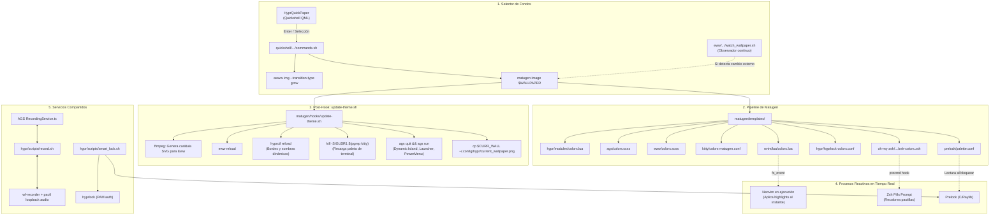

# 🌙 Lunita-Dots

<div align="center">


**Ecosistema de dotfiles altamente sincronizado, reactivo y estético para Hyprland en Arch Linux.**  
*Configuración nativa en Lua, tematización dinámica automática con Matugen, barra Dynamic Island, widgets flotantes en Eww, transiciones de bloqueo en C/Raylib y selector de fondos 3D.*

</div>

---

## 📑 Tabla de Contenidos

- [Visión General](#-visión-general)
- [Arquitectura: ¿Cómo trabajan entre sí?](#-arquitectura-cómo-trabajan-entre-sí)
- [Sistema Multitema & Lunita Theme Manager](#-sistema-multitema--lunita-theme-manager)
- [Estructura del Codebase](#-estructura-del-codebase)
- [Dependencias del Sistema](#-dependencias-del-sistema)
- [Guía de Instalación Paso a Paso](#-guía-de-instalación-paso-a-paso)
  - [1. Clonar el repositorio](#1-clonar-el-repositorio)
  - [2. Aplicar Tema 1 (Lunita Default) con lunita-theme](#2-aplicar-tema-1-lunita-default-con-lunita-theme)
  - [3. Instalar Fuentes Tipográficas](#3-instalar-fuentes-tipográficas)
  - [4. Compilar e Instalar Prelock](#4-compilar-e-instalar-prelock)
  - [5. Configurar AGS (Dynamic Island y Launcher)](#5-configurar-ags-dynamic-island-y-launcher)
  - [6. Configurar Eww & CAVA](#6-configurar-eww--cava)
  - [7. Configurar HyprQuickPaper](#7-configurar-hyprquickpaper)
  - [8. Configurar SDDM (Qylock Orbital)](#8-configurar-sddm-qylock-orbital)
  - [9. Configurar Zsh & Oh My Zsh](#9-configurar-zsh--oh-my-zsh)
  - [10. Primer inicio y generación de tema](#10-primer-inicio-y-generación-de-tema)
- [Atajos de Teclado (Keybindings)](#-atajos-de-teclado-keybindings)
- [Ajustes y Personalización Común](#-ajustes-y-personalización-común)

---

## 🌌 Visión General

**Lunita-Dots** no es un conjunto disperso de configuraciones; es un entorno integrado donde cada herramienta se comunica con las demás en tiempo real:

1. **Hyprland configurado nativamente en Lua**: Modularizado en `modules/` con curvas de animación Bezier estilo macOS (*Sonoma/Ventura*), gestión de pestañas (*tabbed groups*), desenfoque *frosted glass* (size 4, passes 2) y gestos táctiles con `hyprgrass`.
2. **Motor de Colores Dinámicos con Matugen**: Al cambiar de fondo de pantalla (imagen o video), Matugen extrae una paleta armónica Material You y sincroniza simultáneamente Hyprland, AGS, Eww, Kitty, Neovim, Hyprlock, Prelock y Zsh.
3. **AGS v2 (Astal / GTK4 / TypeScript)**:
   - **Dynamic Island**: Pastilla flotante interactiva de 36px con animaciones de expansión, controles de medios, niveles de audio/brillo, overlays de Wi-Fi/Bluetooth, grabación de pantalla en vivo y demonio de notificaciones D-Bus.
   - **App Launcher**: Lanzador con pestañas (`Apps` y `Quick Links`), búsqueda predictiva instantánea y navegación por teclado.
   - **PowerMenu / Control Center**: Panel completo con información del sistema (*FetchCard*), reloj watermark, sliders de audio/brillo, estadísticas circulares de uso de hardware (*StatsCard*), controles multimedia y acciones de energía.
4. **Eww Desktop Widget**: Reproductor multimedia anclado al escritorio (`:stacking "bottom"`) con carátula de álbum y visualizador de espectro de audio en tiempo real (**CAVA**).
5. **HyprQuickPaper (Quickshell / QML)**: Selector de wallpapers 3D acelerado por GPU con más de 10 modos de visualización (*Coverflow*, *Bottom Dock*, *Hexacomb*, *Floating*, *Grid*), soporte de wallpapers de video (`.mp4`, `.webm` con `mpvpaper`) y generación de miniaturas con `ffmpeg`.
6. **Prelock (C11 + Raylib)**: Capa de transición de pantalla completa previa al bloqueo con captura previa de escritorio vía `grim`, shader líquido GLSL y animaciones cinematográficas (*classic*, *swift*, *diagonal*, *meteor*, *liquid*).
7. **Terminal & Entorno de Edición**: Kitty con recarga de colores vía `SIGUSR1`, Neovim con hot-reload dinámico mediante `vim.uv.new_fs_event` sin reiniciar el editor, y Zsh con tema `pills` reactivo a Matugen.
8. **SDDM Qylock Orbital**: Pantalla de inicio de sesión Qt6 minimalista con fondo de video en bucle y reloj orbital de 360°.

---

## 🔄 Arquitectura: ¿Cómo trabajan entre sí?

Todos los componentes están orquestados a través de eventos, hooks y señales del sistema:



### Flujos Clave de Interacción

1. **Ciclo de Fondo y Tematización**:
   - Al seleccionar un wallpaper en **HyprQuickPaper** (`SUPER + W`), `commands.sh` proyecta el fondo usando `awww` con transición `grow`.
   - Se ejecuta `matugen image` en segundo plano. Matugen procesa los 8 templates y dispara `update-theme.sh`.
   - `update-theme.sh` compila una nueva portada SVG para el reproductor de música con los colores primarios y de superficie, recarga Eww, avisa a Hyprland vía `hyprctl reload`, envía `SIGUSR1` a todas las instancias activas de Kitty para cambiar sus colores sin interrumpir la sesión, y reinicia el servicio AGS.
   - Si Neovim está abierto, su observador de sistema de archivos libuv (`vim.uv.new_fs_event`) detecta la escritura en `lua/colors.lua` y vuelve a cargar los grupos de resaltado en memoria automáticamente.
2. **Grabación de Pantalla Sincronizada**:
   - La pastilla **Dynamic Island** de AGS tiene un interruptor de grabación de pantalla y toggles de audio del sistema / micrófono guardados en `ags/recording_config.json`.
   - Al pulsar grabar o usar el atajo (`SUPER + ALT + R`), se ejecuta `hypr/scripts/record.sh`, que configura los sumideros virtuales de PipeWire mediante `pactl` y activa `wf-recorder`.
   - AGS detecta el proceso `wf-recorder`, expande un cronómetro en tiempo real dentro de la pastilla y ofrece el botón de parada.
3. **Bloqueo Inteligente (Smart Lock)**:
   - Al pulsar `SUPER + L`, `hypr/scripts/smart_lock.sh` evita colisiones de bloqueo con `flock`.
   - Si el wallpaper cambió, sincroniza la copia y paleta de Matugen.
   - Lanza **Prelock** (C/Raylib) en el monitor enfocado, mostrando una animación suave (candado cerrándose, rayos expansivos o shader de refracción líquida).
   - Inicia `hyprlock` en primer plano. Cuando el usuario introduce su contraseña y se autentica correctamente, Prelock ejecuta la animación de apertura (anillos disolviéndose suavemente de regreso al escritorio).

---

## 🎨 Sistema Multitema & Lunita Theme Manager

**Lunita-Dots** adopta una arquitectura modular donde cada suite visual se encapsula como un tema autónomo bajo `themes/`. El primer tema del ecosistema es **Tema 1: "Lunita Default"**, el cual agrupa toda la experiencia visual actual (Dynamic Island, notificaciones, widgets Eww, paleta Matugen y animaciones fluidas).

Para administrar, alternar y crear nuevos temas, se incluye la herramienta CLI `lunita-theme` (enlazada automáticamente a `~/.local/bin/lunita-theme`):

```bash
# Ver temas instalados y verificar cuál está activo
lunita-theme list

# Ver los detalles del tema actualmente en uso
lunita-theme current

# Aplicar un tema (enlaza componentes a ~/.config y recarga el entorno)
lunita-theme apply lunita-default

# Generar la estructura base (scaffold) para un nuevo tema (ej. Tema 2)
lunita-theme create tema-2
```

---

## 📁 Estructura del Codebase

```text
Lunita-Dots/
├── themes/                                # 🌟 Directorio central de temas modulares
│   └── lunita-default/                    # 🌙 TEMA 1: "Lunita Default"
│       ├── theme.json                     # Descriptor y metadatos del tema
│       ├── README.md                      # Especificaciones del tema
│       ├── ags/                           # Dynamic Island (36px), AppLauncher, PowerMenu y Notificaciones
│       ├── eww/                           # Widget flotante de escritorio (Música + CAVA)
│       ├── hypr/                          # Configuración visual de Hyprland (animaciones macOS, blur, reglas)
│       ├── kitty/                         # Terminal Kitty con colores reactivos de Matugen
│       ├── matugen/                       # Motor de colores Material You (config.toml, templates, hooks)
│       ├── nvim/                          # Neovim con hot-reload dinámico de colores
│       ├── quickshell/hyprquickpaper/     # Selector de fondos 3D por GPU en Quickshell (QML)
│       ├── wlogout/                       # Menú de cierre de sesión
│       └── zsh/                           # Prompt de pastillas pills sincronizado
├── core/                                  # ⚙️ Componentes transversales del sistema (independientes del tema)
│   ├── hypr/                              # Plantillas base y configuración de hardware (monitors.lua)
│   ├── prelock/                           # Capa Raylib C11 de transición previa al bloqueo
│   └── sddm/                              # Pantalla de inicio de sesión SDDM (Qylock Orbital)
├── scripts/                               # 🛠️ Utilidades del ecosistema
│   └── lunita-theme.sh                    # Gestor CLI de temas (list, apply, current, create)
├── .lunita-theme                          # Indicador de estado del tema activo
└── README.md                              # Documentación del proyecto
```

---

## 📦 Dependencias del Sistema

Las dependencias se encuentran organizadas según la paquetería de **Arch Linux** (`pacman`) y **AUR** (`yay` o `paru`):

### 1. Núcleo de Wayland y Compositor (Hyprland)
```bash
# Repositorios Oficiales
sudo pacman -S hyprland hyprlock hyprpolkitagent xdg-desktop-portal-hyprland \
               pipewire wireplumber pipewire-pulse pipewire-alsa \
               grim slurp wl-clipboard libnotify wf-recorder \
               brightnessctl playerctl jq imagemagick ffmpeg

# AUR (Fondo dinámico, cursores y utilidades)
yay -S awww bibata-cursor-theme-bin
```

> [!NOTE]
> `awww` es el sucesor y fork mantenido de `swww` adoptado en Lunita-Dots para realizar transiciones fluidas de fondo de pantalla sin artefactos visuales.

### 2. Motor de Temas Dinámico (Matugen)
```bash
# AUR
yay -S matugen-bin
```

### 3. Barra de Estado y Widgets (AGS v2 / Astal)
```bash
# Repositorios Oficiales
sudo pacman -S nodejs npm typescript gjs gtk4 libadwaita gobject-introspection

# AUR
yay -S aylurs-gtk-shell-git
```

### 4. Widget de Música y Espectro de Audio (Eww & CAVA)
```bash
# Repositorios Oficiales
sudo pacman -S cava python python-gobject

# AUR
yay -S eww-wayland
```

### 5. Selector de Fondos de Pantalla (Quickshell / HyprQuickPaper)
```bash
# Repositorios Oficiales
sudo pacman -S qt6-declarative qt6-5compat

# AUR
yay -S quickshell-git mpvpaper
```

### 6. Transición de Bloqueo en C/Raylib (Prelock)
```bash
# Repositorios Oficiales (Herramientas de compilación y biblioteca Raylib)
sudo pacman -S base-devel raylib fortune-mod
```

### 7. Terminal, Editor y Shell (Kitty, Neovim, Zsh)
```bash
# Repositorios Oficiales
sudo pacman -S kitty neovim zsh eza

# AUR / Oh My Zsh Plugins
yay -S zsh-autosuggestions zsh-syntax-highlighting zsh-256color
```

### 8. Gestor de Inicio de Sesión (SDDM Qt6)
```bash
# Repositorios Oficiales
sudo pacman -S sddm qt6-multimedia qt6-svg
```

### 9. Fuentes Tipográficas Requeridas
- `JetBrainsMono Nerd Font` (`sudo pacman -S ttf-jetbrains-mono-nerd`)
- `Space Grotesk` (incluida en `themes/lunita-default/ags/fonts/SpaceGrotesk.ttf`)
- `Material Symbols Rounded` (incluida en `themes/lunita-default/ags/fonts/MaterialSymbolsRounded.ttf`)
- `ndot-47` (incluida en `themes/lunita-default/ags/fonts/ndot-47-inspired-by-nothing.otf`)
- `Cinzel` y `Cormorant Garamond` (incluidas en `core/sddm/themes/qylock-orbital/font/`)

---

## 🚀 Guía de Instalación Paso a Paso

### 1. Clonar el repositorio

Clona el repositorio en una carpeta de tu preferencia (por ejemplo `~/.dotfiles` o manteniéndolo en tu directorio de desarrollo):

```bash
git clone https://github.com/Facuud2/Lunita-Dots.git ~/.dotfiles
cd ~/.dotfiles
```

### 2. Aplicar Tema 1 (Lunita Default) con `lunita-theme`

Aplica el tema predeterminado usando el gestor de temas integrado. Esto creará los enlaces simbólicos en `~/.config/` apuntando a `themes/lunita-default/`, instalará el comando en `~/.local/bin/lunita-theme` y preparará el entorno:

```bash
chmod +x scripts/lunita-theme.sh
./scripts/lunita-theme.sh apply lunita-default
```

### 3. Instalar Fuentes Tipográficas

Copia las fuentes incluidas en el repositorio a tu directorio de usuario para que el sistema y AGS las reconozcan:

```bash
mkdir -p ~/.local/share/fonts
cp -r ~/.dotfiles/themes/lunita-default/ags/fonts/* ~/.local/share/fonts/
cp -r ~/.dotfiles/core/sddm/themes/qylock-orbital/font/* ~/.local/share/fonts/
fc-cache -fv
```

### 4. Compilar e Instalar Prelock

Entra en la carpeta de `core/prelock` y compílalo usando Make:

```bash
cd ~/.dotfiles/core/prelock
make
make install
```

> [!TIP]
> `make install` instalará automáticamente el ejecutable en `~/.local/bin/prelock` y los shaders en `~/.local/share/prelock/shaders/liquid_glass.fs`. Asegúrate de que `~/.local/bin` esté presente en tu variable `$PATH`.

### 5. Configurar AGS (Dynamic Island y Launcher)

Instala las dependencias de Node.js necesarias para el frontend de AGS:

```bash
cd ~/.dotfiles/themes/lunita-default/ags
npm install
```

Prueba que el entorno compile y ejecute correctamente:
```bash
ags run
```
*(Puedes detenerlo con `Ctrl + C`, Hyprland lo iniciará automáticamente al arrancar).*

### 6. Configurar Eww & CAVA

Asegúrate de que los scripts de Eww tengan permisos de ejecución:

```bash
chmod +x ~/.dotfiles/themes/lunita-default/eww/scripts/*.sh
chmod +x ~/.dotfiles/themes/lunita-default/eww/scripts/media.py
```

### 7. Configurar HyprQuickPaper

1. Abre el archivo de configuración `~/.config/quickshell/hyprquickpaper/config.json` y asegúrate de que la ruta de tus wallpapers apunte a tu directorio de imágenes:
   ```json
   {
     "wallpaper_tool": "awww",
     "wallpaper_path": "~/Pictures/Wallpapers/",
     "cache_path": "~/.cache/quickshell/thumbs/"
   }
   ```
2. Ejecuta el script de instalación para verificar dependencias y generar miniaturas iniciales:
   ```bash
   cd ~/.config/quickshell/hyprquickpaper
   chmod +x install.sh commands.sh cache.sh
   ./install.sh
   ```

### 8. Configurar SDDM (Qylock Orbital)

Instala el tema en el sistema mediante el instalador provisto:

```bash
cd ~/.dotfiles/core/sddm/themes/qylock-orbital
chmod +x install.sh preview.sh
./install.sh
```

*(Puedes comprobar el aspecto del tema en cualquier momento sin cerrar sesión ejecutando `./preview.sh`).*

### 9. Configurar Zsh & Oh My Zsh

1. Si no tienes **Oh My Zsh**, instálalo:
   ```bash
   sh -c "$(curl -fsSL https://raw.githubusercontent.com/ohmyzsh/ohmyzsh/master/tools/install.sh)"
   ```
2. Enlaza el tema de pastillas `pills.zsh-theme` y tu `.zshrc`:
   ```bash
   ln -sf ~/.dotfiles/themes/lunita-default/zsh/pills.zsh-theme ~/.oh-my-zsh/custom/themes/pills.zsh-theme
   ln -sf ~/.dotfiles/themes/lunita-default/zsh/.zshrc ~/.zshrc
   ```

### 10. Primer inicio y generación de tema

Asegúrate de que el demonio `awww` esté corriendo y selecciona tu primer fondo de pantalla para generar todos los colores de Matugen:

```bash
# Iniciar awww
awww-daemon &

# Aplicar un wallpaper y generar la paleta
awww img /ruta/a/tu/wallpaper.jpg
matugen image /ruta/a/tu/wallpaper.jpg --source-color-index 0
```

¡Listo! A partir de este momento, cada vez que abras el selector con `SUPER + W`, todo tu escritorio se re-tematizará de forma instantánea y armónica.

---

## ⌨️ Atajos de Teclado (Keybindings)

El modificador principal es la tecla `SUPER` (Windows):

| Atajo | Acción | Descripción |
|---|---|---|
| <kbd>SUPER</kbd> + <kbd>Espacio</kbd> | **Toggle Dynamic Island** | Expande o colapsa el panel superior de AGS |
| <kbd>SUPER</kbd> + <kbd>A</kbd> | **Toggle App Launcher** | Abre el lanzador de aplicaciones y accesos rápidos |
| <kbd>SUPER</kbd> + <kbd>W</kbd> | **Wallpaper Picker** | Abre HyprQuickPaper en Quickshell |
| <kbd>SUPER</kbd> + <kbd>Q</kbd> | **Terminal** | Lanza Kitty con opacidad y colores coordinados |
| <kbd>SUPER</kbd> + <kbd>B</kbd> | **Navegador Web** | Lanza Zen Browser (o navegador predeterminado) |
| <kbd>SUPER</kbd> + <kbd>Shift</kbd> + <kbd>B</kbd> | **Navegador Privado** | Lanza Zen Browser en modo incógnito |
| <kbd>SUPER</kbd> + <kbd>E</kbd> | **Gestor de Archivos** | Lanza Dolphin |
| <kbd>SUPER</kbd> + <kbd>X</kbd> | **IDE / Editor** | Lanza el entorno de desarrollo configurado |
| <kbd>SUPER</kbd> + <kbd>R</kbd> | **Menú Rofi** | Abre el menú de comandos alternativo |
| <kbd>SUPER</kbd> + <kbd>C</kbd> | **Cerrar Ventana** | Cierra la ventana activa |
| <kbd>SUPER</kbd> + <kbd>V</kbd> | **Toggle Flotante** | Alterna entre ventana en mosaico y flotante |
| <kbd>SUPER</kbd> + <kbd>J</kbd> | **Toggle Split** | Alterna la dirección de división en Dwindle |
| <kbd>SUPER</kbd> + <kbd>G</kbd> | **Crear / Desarmar Grupo** | Une ventanas en una interfaz por pestañas (*tabs*) |
| <kbd>SUPER</kbd> + <kbd>TAB</kbd> | **Siguiente Pestaña** | Avanza a la siguiente ventana del grupo |
| <kbd>SUPER</kbd> + <kbd>Shift</kbd> + <kbd>TAB</kbd> | **Pestaña Anterior** | Retrocede a la ventana anterior del grupo |
| <kbd>SUPER</kbd> + <kbd>Ctrl</kbd> + <kbd>G</kbd> | **Bloquear Grupo** | Fija el grupo de pestañas activo |
| <kbd>SUPER</kbd> + <kbd>L</kbd> | **Smart Lock** | Bloqueo animado con Prelock (C/Raylib) + Hyprlock |
| <kbd>SUPER</kbd> + <kbd>M</kbd> | **Cierre de Sesión** | Ejecuta hyprshutdown o cierra Hyprland |
| <kbd>Print</kbd> | **Captura de Área** | Selecciona un área con `slurp` y la copia al portapapeles |
| <kbd>Shift</kbd> + <kbd>Print</kbd> | **Captura Completa** | Captura la pantalla completa y envía notificación |
| <kbd>SUPER</kbd> + <kbd>Alt</kbd> + <kbd>R</kbd> | **Grabar Área** | Inicia grabación de área con `wf-recorder` |
| <kbd>SUPER</kbd> + <kbd>Shift</kbd> + <kbd>R</kbd> | **Grabar Pantalla** | Inicia grabación de pantalla completa con audio |
| <kbd>SUPER</kbd> + <kbd>Esc</kbd> | **Detener Grabación** | Detiene cualquier grabación de pantalla activa |
| <kbd>SUPER</kbd> + <kbd>1</kbd> .. <kbd>0</kbd> | **Cambiar Workspace** | Cambia al escritorio virtual 1 al 10 |
| <kbd>SUPER</kbd> + <kbd>Shift</kbd> + <kbd>1</kbd> .. <kbd>0</kbd> | **Mover a Workspace** | Mueve la ventana activa al escritorio especificado |
| <kbd>SUPER</kbd> + <kbd>S</kbd> | **Special Workspace** | Alterna el espacio de trabajo mágico (*scratchpad*) |
| <kbd>Fn / Teclas Multimedia</kbd> | **Audio / Brillo / Media** | Controles de volumen con `wpctl`, brillo con `brightnessctl` y música con `playerctl` |

---

## 🛠️ Ajustes y Personalización Común

### Modificar Monitores y Tasa de Refresco
Edita `hypr/modules/monitors.lua` con los conectores de tus pantallas (`hyprctl monitors`):
```lua
hl.monitor({
    output   = "DP-1",
    mode     = "1920x1080@240",
    position = "0x0",
    scale    = "1",
})
```

### Cambiar Programas Predeterminados
Edita el bloque inicial de `hypr/hyprland.lua`:
```lua
local programs = {
    terminal    = "kitty",
    fileManager = "dolphin",
    menu        = "rofi -show drun",
    browser     = "zen-browser",
    ide         = "antigravity",
    music       = "spotify",
}
```

### Cambiar el Estilo de Animación de Prelock
En `hypr/modules/keybinds.lua` puedes cambiar el modo de animación que se le pasa al script de bloqueo (`classic`, `swift`, `diagonal`, `meteor` o `liquid`):
```lua
hl.bind(mod .. " + L", hl.dsp.exec_cmd(scripts_dir .. "/smart_lock.sh meteor"))
```
*(Si no se especifica ningún argumento, Prelock seleccionará uno aleatoriamente).*

### Cambiar el Diseño de HyprQuickPaper
En `~/.config/quickshell/hyprquickpaper/shell.qml` puedes seleccionar cuál de los múltiples diseños se carga por defecto (por ejemplo `shell-coverflow.qml`, `shell-bottom-dock.qml`, `shell-hexcomb.qml`, etc.).

---

<div align="center">
  <sub>Diseñado con cariño para disfrutar de un entorno Wayland ágil, hermoso y perfectamente sincronizado.</sub>
</div>
